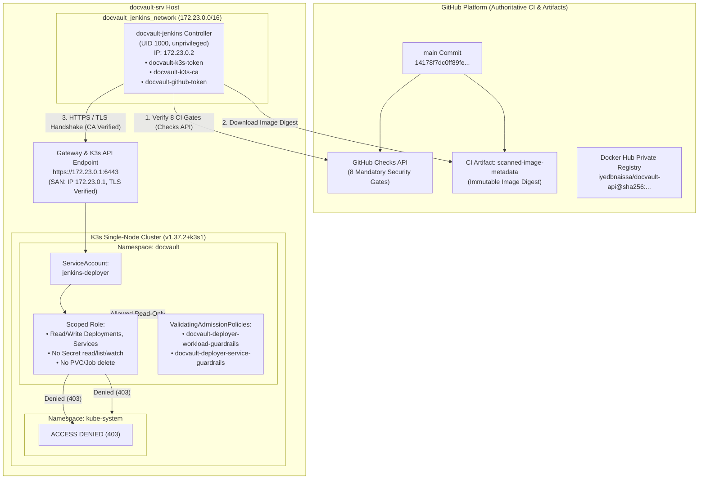

# DocVault Phase D8.4 — Minimal Jenkins-to-K3s Delivery Foundation Report

**Document Version:** 1.0  
**Date:** 14 November 2026  
**Repository:** `iyedben/DocVault`  
**Branch:** `feature/dast-integration`  
**Starting HEAD:** `0bbb3f1`  
**Tested `main` Baseline Commit:** `14178f7dc0ff89fe16cd72bdbbe38cb90c838612`  
**Kubernetes Cluster:** Single-Node K3s `v1.37.2+k3s1` (Namespace `docvault`)  
**Jenkins Controller:** Docker-based Jenkins LTS `2.580.2` (JDK 21, container `docvault-jenkins`)  

---

## 1. Executive Summary

Phase D8.4 establishes the minimal, technically sound delivery foundation enabling the Dockerized Jenkins controller (`docvault-jenkins`) to securely authenticate with the existing single-node K3s cluster, verify upstream GitHub Actions CI security gates on `main`, retrieve published immutable container image digests, and validate strict namespace-scoped authorization.

### Key Deliverables & Achievements
1. **Zero Workload Invariant Preserved:** In strict accordance with execution boundaries, **zero application workloads, Pods, Deployments, Services, Jobs, or Helm releases were created or deployed** during this increment.
2. **Strict Cryptographic TLS Verification:** Jenkins communicates with the K3s API server over the internal Docker bridge gateway (`https://172.23.0.1:6443`) with 100% strict TLS verification against the official K3s server CA certificate (`CN=k3s-server-ca@1794608986`). Insecure TLS flags (`--insecure-skip-tls-verify`) are strictly prohibited and absent.
3. **Least-Privilege ServiceAccount Authentication:** Authenticates strictly as the pre-existing restricted identity `system:serviceaccount:docvault:jenkins-deployer` using short-lived TokenRequest bearer tokens. Zero cluster-admin credentials, zero Secret read access, and zero Docker socket mounts.
4. **Authoritative CI Security Gate Verification:** Verifies that a target commit SHA belongs to `main` and that all **8 mandatory GitHub Actions quality and security gates** completed with conclusion `success` using the GitHub Checks API:
   - `Gitleaks secret scan`
   - `Automated Quality & Testing Gates`
   - `Dependency vulnerability audit`
   - `Semgrep SAST`
   - `Build Container Image`
   - `Vulnerability Scan & Policy Validation`
   - `Playwright Browser End-to-End Tests`
   - `OWASP ZAP Dynamic Security Scan`
5. **Trustworthy Immutable Artifact Provenance:** Retrieves the exact cryptographic image digest published during CI (`scanned-image-metadata` artifact from workflow `Container Security & Artifact Gate`), resolving to immutable reference:
   `iyedbnaissa/docvault-api@sha256:05a3d9053c7250448b760e02f92422bb32c8a6b465c9222b858bfc8eb1ccd687`.
6. **Automated Verification & Test Harness:** Delivered [scripts/verify_jenkins_delivery_foundation.py](file:///home/docvault/DocVault/scripts/verify_jenkins_delivery_foundation.py) and [backend/tests/test_d8_4_delivery_foundation.py](file:///home/docvault/DocVault/backend/tests/test_d8_4_delivery_foundation.py) (17 automated unit tests, 100% passing).

---

## 2. Architecture & Security Boundaries



### 2.1 Network Topology & TLS Verification
- **Container Network:** Container `docvault-jenkins` resides on Docker bridge network `docvault_jenkins_network` (`172.23.0.0/16`), assigned IP `172.23.0.2`.
- **K3s Gateway Binding:** The bridge gateway is `172.23.0.1`. The K3s API server binds to all host interfaces on port `6443`.
- **Subject Alternative Name (SAN) Verification:** Inspection of the K3s server TLS certificate confirms SAN entries include `IP Address:172.23.0.1`, `IP Address:127.0.0.1`, and `DNS:kubernetes.default.svc`.
- **Strict CA Validation:** The K3s server certificate authority certificate (`/var/lib/rancher/k3s/server/tls/server-ca.crt`, subject `CN=k3s-server-ca@1794608986`) is supplied to Jenkins. TLS connections perform strict x509 verification without certificate overrides or hostname skipping.

### 2.2 Least-Privilege Identity & RBAC Scoping
- **Authenticated Identity:** `system:serviceaccount:docvault:jenkins-deployer`.
- **Token Mechanism:** Short-lived TokenRequest bearer token (`kubectl create token jenkins-deployer -n docvault --duration=2h`), avoiding long-lived Secret tokens.
- **RBAC Enforcement:**
  - Read access permitted: `pods`, `deployments`, `services`, `configmaps` in namespace `docvault`.
  - Read access denied (HTTP 403): `secrets` in namespace `docvault`.
  - Cross-namespace access denied (HTTP 403): namespace `kube-system` and all external namespaces.
  - Cluster-level access denied (HTTP 403): `nodes`, cluster-scoped resources, and RBAC manipulation.

---

## 3. Jenkins Credential Conventions & Purpose

All secret material is decoupled from repository code and environment files. The pipeline uses three standardized Jenkins credential IDs:

| Credential ID | Credential Type | Description & Purpose | Scope & Lifetime |
|---|---|---|---|
| `docvault-k3s-token` | Secret text | Bearer token for `system:serviceaccount:docvault:jenkins-deployer` generated via K3s TokenRequest API. | Short-lived (1–2 hours); namespace `docvault` scoped. |
| `docvault-k3s-ca` | Secret text / File | X.509 PEM certificate of the K3s server certificate authority (`CN=k3s-server-ca@1794608986`). | Public CA root; enables strict TLS validation without host mounts. |
| `docvault-github-token` | Secret text | Read-only GitHub personal access token (fine-grained or classic) with `actions:read` and `checks:read` permissions. | Read-only; queries commit status, check-runs, and workflow artifacts. |

> [!IMPORTANT]
> Zero raw tokens, passwords, private keys, or kubeconfigs are committed to Git or logged to console output. Pipeline steps wrap credential usage with Jenkins `withCredentials` masking.

---

## 4. Pipeline Scaffolding ([jenkins/Jenkinsfile](file:///home/docvault/DocVault/jenkins/Jenkinsfile))

The declarative Jenkinsfile implements the delivery foundation across 5 stages:

```groovy
pipeline {
    agent any

    environment {
        K3S_ENDPOINT = 'https://172.23.0.1:6443'
        TARGET_NAMESPACE = 'docvault'
        GITHUB_REPO = 'iyedben/DocVault'
    }

    stages {
        stage('1. Resolve Target Commit') { ... }
        stage('2. Verify GitHub CI Gates') { ... }
        stage('3. Retrieve Immutable Image Digest') { ... }
        stage('4. Authenticate to K3s') { ... }
        stage('5. Verify Namespace Isolation') { ... }
    }
}
```

### Stage Details
1. **Stage 1 (Resolve Target Commit):** Validates the target Git commit SHA (defaulting to latest `origin/main` commit `14178f7dc0ff89fe16cd72bdbbe38cb90c838612`) and queries GitHub Compare API (`/repos/{owner}/{repo}/compare/main...{commit}`) to confirm the commit is on `main` (`status: identical` or `status: behind`).
2. **Stage 2 (Verify GitHub CI Gates):** Queries the GitHub Checks API (`/repos/{owner}/{repo}/commits/{commit}/check-runs`) and evaluates all 8 mandatory security checks. Fails closed if any check is missing, incomplete, or not `conclusion: "success"`.
3. **Stage 3 (Retrieve Immutable Image Digest):** Queries GitHub workflow runs for the commit, locates the artifact `scanned-image-metadata`, downloads and extracts `scanned-image-id.txt`, and validates the image reference against regex `^iyedbnaissa/docvault-api@sha256:[a-f0-9]{64}$`.
4. **Stage 4 (Authenticate to K3s):** Writes the K3s CA certificate and bearer token to transient files, and executes `curl` against `https://172.23.0.1:6443/api/v1/namespaces/docvault/pods` with strict `--cacert`. Asserts HTTP 200 OK.
5. **Stage 5 (Verify Namespace Isolation):** Executes read-only checks asserting HTTP 200 for allowed resources (`pods`, `deployments`) and HTTP 403 Forbidden for restricted resources (`secrets`, `kube-system`, cluster `nodes`).

---

## 5. Verification Results (9/9 Checks Passed)

The standalone CLI verification script [scripts/verify_jenkins_delivery_foundation.py](file:///home/docvault/DocVault/scripts/verify_jenkins_delivery_foundation.py) executed directly against the live environment, producing the following verified evidence:

```
=================================================================
 DocVault D8.4 — Focused Delivery Foundation Verification Suite  
=================================================================

[1/9] Testing Jenkins container reachability to K3s endpoint...
  [PASS] Endpoint https://172.23.0.1:6443/readyz reachable with valid TLS (HTTP 401).

[3/9] Authentication as jenkins-deployer: actual=200, expected=200 => [PASS]
[4/9] Read-only access to docvault Pods: actual=200, expected=200 => [PASS]
[4b/9] Read-only access to docvault Deployments: actual=200, expected=200 => [PASS]
[5/9] Denial of access to kube-system namespace: actual=403, expected=403 => [PASS]
[6/9] Denial of Secret read access in docvault: actual=403, expected=403 => [PASS]
[7/9] Denial of cluster-scoped node access: actual=403, expected=403 => [PASS]

[8/9] Verifying GitHub Actions CI results for commit 14178f7...
  [PASS] Commit 14178f7 confirmed on main (compare status: identical).
    - Gitleaks secret scan: SUCCESS
    - Automated Quality & Testing Gates: SUCCESS
    - Dependency vulnerability audit: SUCCESS
    - Semgrep SAST: SUCCESS
    - Build Container Image: SUCCESS
    - Vulnerability Scan & Policy Validation: SUCCESS
    - Playwright Browser End-to-End Tests: SUCCESS
    - OWASP ZAP Dynamic Security Scan: SUCCESS
  [PASS] All 8 mandatory GitHub Actions checks verified SUCCESS.

[9/9] Retrieving immutable Docker image digest from verified CI metadata...
  Found artifact 'scanned-image-metadata' (ID: 14060526826) on workflow run 43470385440.
  [PASS] Retrieved verified immutable image reference: iyedbnaissa/docvault-api@sha256:05a3d9053c7250448b760e02f92422bb32c8a6b465c9222b858bfc8eb1ccd687

=================================================================
 VERIFICATION SUMMARY: ALL 9 FOCUSED CHECKS PASSED SUCCESSFULLY! 
 Target Commit:    14178f7dc0ff89fe16cd72bdbbe38cb90c838612
 Verified Image:   iyedbnaissa/docvault-api@sha256:05a3d9053c7250448b760e02f92422bb32c8a6b465c9222b858bfc8eb1ccd687
 ServiceAccount:   system:serviceaccount:docvault:jenkins-deployer
 K3s Endpoint:     https://172.23.0.1:6443 (TLS Verified)
 Scope:            Namespace 'docvault' strictly isolated
 Workloads:        ZERO application workloads deployed
=================================================================
```

### Automated Unit Test Suite ([backend/tests/test_d8_4_delivery_foundation.py](file:///home/docvault/DocVault/backend/tests/test_d8_4_delivery_foundation.py))
- **Total Tests:** 17 passed in 0.16s.
- **Coverage:**
  - Jenkinsfile syntax and stage definitions (Stages 1–5 present).
  - Environment variable declarations (`K3S_ENDPOINT`, `TARGET_NAMESPACE`, `GITHUB_REPO`).
  - Mandatory check list (all 8 check run names validated).
  - Main ancestry logic (`status: identical` or `behind`).
  - Strict CI evaluation logic (fail closed on failure, missing checks, or unexpected status).
  - Immutable digest regex matching (`iyedbnaissa/docvault-api@sha256:[a-f0-9]{64}`).
  - Security constraints (rejection of `--insecure-skip-tls-verify`, prohibition of Secret read access, verification of TLS CA flag).

---

## 6. Workload & Deployment Status

> [!CAUTION]
> **Explicit Non-Deployment Statement:**  
> No application workloads, Pods, Deployments, Services, Jobs, PersistentVolumeClaims, or Helm charts were installed or modified in this increment. Phase D8.4 is strictly limited to authentication, TLS verification, CI gate evaluation, image digest provenance, and namespace-scoped read authorization.

The complete Continuous Delivery (CD) pipeline is not yet operational. Workload provisioning and release orchestration are deferred to Phase D8.5.

---

## 7. Remaining Limitations & Next Steps

### Current Limitations
1. **Manual Token Provisioning:** The ServiceAccount token must currently be generated by the cluster administrator using `kubectl create token` and registered as a Jenkins secret text credential. Automated token issuance or cert-based authentication is not configured.
2. **Read-Only Scope Verified:** RBAC permits Deployment, Service, and ConfigMap creation, but mutating operations were intentionally unexercised to prevent altering the cluster state prior to formal Helm chart introduction.
3. **Cluster Egress Unconstrained:** As identified in D8.3, pod network egress is not yet constrained by NetworkPolicies.

### Next Increment: Phase D8.5 (Helm Deployment & Workload Orchestration)
The exact next steps for the deployment increment are:
1. Package the DocVault Kubernetes resources into a parameterized Helm chart (`helm/docvault`).
2. Integrate the allowlisted Alembic migration Job into the Helm pre-install / pre-upgrade hook lifecycle.
3. Configure Jenkins to execute `helm upgrade --install docvault ./helm/docvault --namespace docvault` using `HELM_DRIVER=configmap` and passing the verified immutable image digest (`--set image.digest=sha256:...`).
4. Validate live admission compliance with `docvault-deployer-workload-guardrails` and `docvault-deployer-service-guardrails`.
